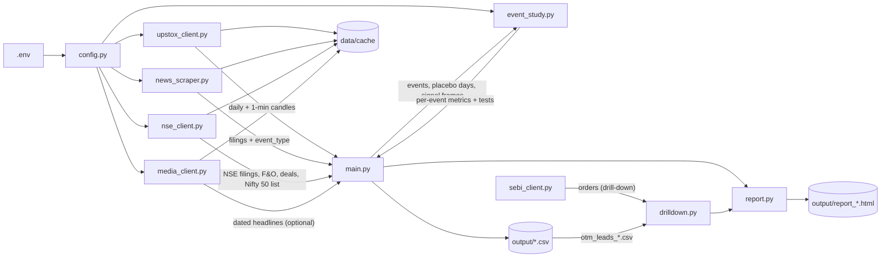

# Architecture

## Overview

This is a flat Python script pipeline with no framework or package. Four data-access modules fetch and cache data as pandas DataFrames:

- `upstox_client.py`: daily and 1-minute prices
- `news_scraper.py`: BSE filings
- `nse_client.py`: NSE filings, F&O activity, deals and constituents
- `media_client.py`: press coverage and broker actions
- `sebi_client.py`: SEBI enforcement orders (drill-down only)

`event_study.py` is pure computation: it turns those frames into per-event metrics, tests and the leads ranking. `report.py` renders the HTML report and the drill-down page. `main.py` runs one stock or a pooled universe (e.g. all Nifty 50). `drilldown.py` investigates the option-flow leads. `config.py` is the single source of constants and credentials, and every other module imports it.

**The question:** do prices, volume and positioning move in the direction of material news *before* it is public?

**How it's tested:** each event's pre-window is compared against its own baseline and against random non-event days for the same stocks (placebo). For a plain-language overview with data sources and findings, see [STUDY.md](STUDY.md).

## How it fits together



A run of `python main.py --universe nifty50` works like this:

1. **Universe.** `NSEClient.get_nifty50()` gives symbols and ISINs. Each NSE instrument key is `NSE_EQ|<ISIN>`, and `UpstoxClient.get_bse_scrip()` finds the BSE scrip by the same ISIN in the instrument master's `BSE_EQ` rows. `config.SAMPLE_STOCKS` overrides the lookup. Stocks without a BSE listing (BSE Ltd itself) are skipped.
2. **Market.** Nifty 50 daily candles are fetched once and shared by every stock.
3. **Per stock** (`study_stock`):
   1. Daily candles.
   2. BSE filings, classified by `BSEScraper.classify`.
   3. `earliest_exchange_time` moves a filing to its NSE broadcast time when NSE carried it first.
   4. `build_events` assigns Day 0 and merges same-day filings.
   5. `placebo_events` draws non-event days.
   6. Optional signal frames (F&O, deals, intraday, insider trades) and the stock's sector index are fetched and passed to `run_event_study`, which runs for both the events and the placebo days.
   7. Media lead and broker actions are added for unscheduled events when `media` is on.

   A network failure skips that stock (after retries) instead of stopping the run.
4. **Pooling.** Per-stock results are concatenated. `tests_table` runs `leakage_tests` for each group (all, non-overlapping, unscheduled, scheduled, media splits) and for the placebo days.
5. **Output.**
   - The terminal tables (single-stock runs also print the per-event table).
   - `output/event_study_<SYM>_*.csv`, or `panel_events_*.csv` for pooled runs.
   - `placebo_*.csv`, `tests_*.csv` and the `bse_filings_*` audit CSVs.
   - `otm_leads_*.csv` (from `rank_directional_otm`).
   - `report_*.html`.
6. **Drill-down** (separate command). `drilldown.py` reads the latest leads CSV and fetches per-contract option data, prices, filings and press for each lead. It writes `drilldown_*.html` and `drilldown_contracts_*.csv`.

## Methodology

### Day-0 assignment (`assign_day0`)

All times are IST, as the exchanges publish them.

| Filing time | Day 0 | Session label |
|---|---|---|
| > 15:30:00 | next trading day | Post-close |
| 09:15:00 – 15:30:00 (inclusive) | same day | Intraday |
| < 09:15:00 | same day | Pre-open |
| on a weekend/holiday | next trading day | Non-trading day |

- **Trading calendar:** the stock's own candle index, so there is no separate holiday list.
- **Public time:** the earlier of the BSE and NSE broadcasts. The nearest NSE filing within `EXCHANGE_MATCH_MINUTES` (10) is treated as the same disclosure. In the RELIANCE sample, 36 of 39 material filings matched, with leads of 17 s – 8 min in either direction. It only changes Day 0 near the 15:30 boundary.

### Windows (trading-day offsets from Day 0 at index *i*)

```
| baseline: 30 sessions |  pre [t-5, t-1]  | t0 |  post [t+1, t+5]  |
  i-35            i-6     i-5        i-1    i    i+1         i+5
```

The baseline ends before the pre-window starts, so the drift being tested never contaminates its own reference. All offsets come from `config.PRE_WINDOW`, `POST_WINDOW` and `BASELINE_DAYS`.

### Price and volume metrics (`measure_event`)

- `ar = r_stock − r_nifty50`. This is market-adjusted: 30 days is too short to estimate a beta reliably.
- `pre_ret`, `pre_car = Σ ar` over the pre-window, and `pre_car_z = pre_car / (σ_baseline(ar) · √5)`.
- `vol_ratio`, `vol_z`, `vol_peak_z` (pre-window volume against the baseline).
- `day0_ar`, `day0_z`, `post_car`, `post_car_z`.
- Daily ARs `ar_-10 … ar_+5` (`CAR_PATH_WINDOW`), used for the report's average path.

### Direction and the leakage tests (`add_direction_metrics`, `leakage_tests`)

Good-news and bad-news leakage cancel out in a plain mean of `pre_car`, so every pre-window metric is **signed by the direction of the news**:

- `direction = sign(day0_ar + post_car)`, or `day0_ar` alone while the post-window is pending.
- `signed_pre_car = direction · pre_car`. A value > 0 means prices moved the news' way before it was public.
- `runup_ratio = pre_car / (pre_car + day0_ar)` (Keown–Pinkerton), for total moves of at least 1%. On its own it is uninformative: placebo days show a similar median because both terms are noise there.

Per group, `leakage_tests` reports:

| Test | What it is |
|---|---|
| t-test | one-sample t on `signed_pre_car` |
| BMP | the same t-test on `signed_pre_car_z` (each event standardised by its own volatility) |
| Sign test | share of events whose pre-drift points the right way, binomial against 50% |
| Placebo p | one-sided bootstrap: share of same-size random draws of placebo days with a mean at least as large |
| Positioning signals | mean, and a Welch t-test against the placebo days (not against 0: option volume, OI and deal frequency all have non-zero baselines) |

**Groups:**

- **All events**, and **non-overlapping** events (no other Day 0 within [t-5, t+5]).
- **Unscheduled** vs **scheduled** non-overlapping events. Scheduled means `SCHEDULED_TYPES`: results, dividends and board outcomes, whose date is pre-announced. Leakage evidence is much more meaningful for unscheduled news.
- With `media`: **unscheduled, media first** vs **unscheduled, no prior media**.

### Placebo days (`placebo_events`)

- **Count:** up to `PLACEBO_PER_STOCK` (20) random sessions per stock in the same calendar span.
- **Spacing:** at least `PLACEBO_MIN_GAP` (6) sessions from any event and from each other, which keeps every event's Day 0 out of a placebo's [t-5, t+5].
- **Measurement:** placebo days go through the same `run_event_study`, including the F&O, deal and intraday signals (intraday at 12:00), so every metric has an empirical null.
- **Expected values:** placebo signed pre-CAR is about 0 and its sign test about 50%. If not, something is wrong.

### F&O positioning (`measure_fno`, signal `fno`)

- **Source:** NSE daily F&O bhavcopy, UDiFF format, available from July 2024. One zip per session is aggregated into `data/cache/nse_fo2_<YYYYMMDD>.csv` and shared by every stock. It has one row per (symbol, kind FUT/CE/PE, expiry, `otm`) with volume and OI, plus a `front` flag for each symbol's nearest expiry. `otm` means at least `OTM_MIN_MONEYNESS` (2%) out of the money against that day's underlying price. `fo_daily` rolls these rows up to per-session totals.
- **OI changes run from close of t-6 to close of t-1 on total OI, skipping the step right after an expiry** (`_oi_chg_ex_expiry`).
  - Rollover moves OI from the front month to the next and leaves the total unchanged. The unrolled remainder vanishes in the session *after* expiry; the bhavcopy still lists the series on expiry day. Skipping that one step removes the drop.
  - Restricting to contracts alive at t-1 does **not** work: it books the whole rollover inflow as new positions (+65% on placebo days in testing).
- **Metrics:**

  | Metric | Meaning |
  |---|---|
  | `fut_oi_chg_pre` | futures OI change, as above |
  | `opt_oi_chg_pre`, `call_oi_chg_pre`, `put_oi_chg_pre` | option OI changes, the same way |
  | `signed_oi_tilt` | `direction · (call_oi_chg_pre − put_oi_chg_pre)`: calls building faster than puts before good news is > 0 |
  | `opt_vol_z` | pre-window option volume against the baseline |
  | `call_skew_z`, `signed_call_skew_z` | call share of option volume, as a standard error of the mean |
  | `otm_ce_vol_z`, `otm_pe_vol_z` | front-month OTM call and put volume, each against its own baseline |
  | `news_side_otm_vol_z`, `wrong_side_otm_vol_z` | the same split by news direction: calls before good news, puts before bad. The wrong side is the control. |

  The OTM split follows the literature: informed traders buy cheap, short-dated OTM options.
- **The expiry cycle matters for OI.** Option OI builds through each monthly cycle; on placebo days the median 5-day change runs from −4% just after expiry to +32% 6–10 sessions in. Events and placebo days are spread across the cycle similarly, so the placebo comparison is fair. When reading a group's OI number, still check it against the cycle: scheduled events stayed +13% above placebo when matched on sessions-since-expiry.
- **Upstox alternative:** `--oi-source upstox` uses expired near-month futures (Plus plan). It covers futures only and stops at the last expiry. Prefer NSE.

**Drill-down data.** On top of the day table and contracts:

- **1-minute profile** (`minute_profile`): for the top 3 contracts, from Upstox expired-instrument minute candles (`get_expired_option_contracts`, `get_expired_minutes`; Plus plan). It shows contracts per session, the share bought in the first 15 minutes of sessions (a gap reaction to overnight news) and in the last 60 trading minutes before the public time, and the busiest minutes.
- **Insider trades** in [t-30, t-1], by category.
- **SEBI orders** (`SebiClient.search_orders`): a title search on the company name and symbol. Titles about insider trading or leaked price-sensitive information are highlighted.

**Drill-down (`option_flow_by_day`, `top_contracts`, `drilldown.py`).** For each lead it shows the news-side vs wrong-side OTM volume from t-10 to t+1, and the news-side contracts with the most pre-window volume against their own baseline. It also shows each contract's premium at t-1 vs Day 0 (did the buyers profit from the news?), plus filings and press. On the first 8 leads every winning trade had a public explanation (a broker upgrade, Venezuela news, a same-day media report). Treat leads as a screen, not as evidence.

**Leads list (`rank_directional_otm`).** Unscheduled, non-overlapping events are kept when `news_side_otm_vol_z ≥ 1.96` and the news side exceeds the wrong side. They are ranked by the gap and written to `output/otm_leads_*.csv` and the report. Many leads are "Clarification sought" events, where the media report came before the filing; check the press timeline before treating a lead as insider trading.

### Bulk and block deals (`measure_deals`, signal `deals`)

- **Source:** NSE `historicalOR/bulk-block-short-deals`, queried per symbol for each deal kind, cached per date range.
- **Metrics:** `deal_any`, `deal_count` and `deal_value_cr` over `DEALS_WINDOW` [t-30, t-1]. Value counts one side of each trade.
- **Interpretation:** for Nifty 50 stocks these are almost all institutional crossings (ODI rebookings, fund transfers), not insiders. Treat them as context.

### Intraday (`measure_intraday`, signal `intraday`)

- **Which events:** only those whose public time falls inside market hours *on Day 0 itself*. Their "minutes before" is well defined.
- **Pre-window:** [filing − `INTRADAY_PRE_MINUTES`, filing minute), clipped to 09:15. Windows shorter than `INTRADAY_MIN_MINUTES` are skipped. Only bars that finished before the filing minute are used.
- **Baseline:** the same clock window on the prior `INTRADAY_BASELINE_DAYS` (20) sessions.
- **Metrics:** `intra_pre_ar(_z)` (stock minus Nifty, 1-minute bars) and `intra_vol_ratio` / `intra_vol_z`.
- **Signing:** by the reaction *after* the filing (`intra_post_ar`, filing to close, plus `post_car`), not Day 0's AR, which contains the pre-filing minutes themselves.
- **Data:** Upstox v3 `historical-candle/.../minutes/1`, one calendar month per request. Completed months are cached as `data/cache/intraday_<key>_<YYYYMM>.csv.gz`.

### Media lead (`media_lead`, signal `media`, opt-in)

- **Source:** Google News RSS search for the company name over [filing − 7 days, filing day], unscheduled events only.
- **Match rule:** an article matches when its title shares `MEDIA_MIN_KEYWORDS` (2) distinctive keywords with the event headline. Words in more than `MEDIA_MAX_DOC_FREQ` (2%) of the company's fetched headlines are generic (`generic_words`) and don't count. Without that rule, "consumer" and "products" matched every Reliance Consumer Products story.
- **Output:** `media_prior` / `media_lead_days`, counting articles dated strictly before the filing day.
- **Limits:**
  - Historical items carry only a date, so same-day coverage can't be ordered against the filing.
  - **Google returns different result sets for the same query between runs** (9 items vs ~100 seen in testing), so "no prior media" is unreliable. That is why the signal is opt-in.

### Insider trades (`measure_insider`, signal `insider`)

- **Source:** SEBI PIT system-driven disclosures from BSE `sddpit/w` (`BSEScraper.get_insider_trades`). The endpoint was found in the BSE website's JS bundle. NSE's `corporates-pit` is not used: it returns zero rows for whole stocks (HDFCBANK, TCS), where BSE has about 1,500 a year.
- **Privacy:** person names are dropped at fetch time; only category, side, shares, value and dates are kept.
- **Metrics:** over `INSIDER_WINDOW` [t-30, t-1] by **trade date** (disclosures are filed a median ~6 days later), we compute `insider_any`, `insider_trades`, `insider_net_cr` (buy − sell value, ₹ crore) and `insider_net_signed_cr = direction · insider_net_cr`.
- **Caveats:** insiders are barred from trading before results (trading-window closure), so expect fewer insider trades before scheduled events. ESOP-related buys count as buys.

### Public-catalyst controls

Most false leads come from public news that isn't a company filing. Four controls:

- **Sector-adjusted drift.** `prepare_prices` adds `sec_ar` (stock minus sector index) when a sector index is given. Industries map to NSE sector indices in `config.SECTOR_INDEX`; banks override to Nifty Bank. `measure_event` then reports `sector_pre_car(_z)`, and `sector_signed_pre_car` uses the same news direction. The stock is part of its own index, so this slightly understates drift for the heaviest index weights.
- **Macro and sector shocks.** `macro_shock` is a pre-window day with |Nifty return| ≥ 2%. `sector_shock` is a day with |sector − Nifty| ≥ 2%.
- **Broker actions** (with `media`). `MediaClient.search_broker` searches Google News for rating and target news. `broker_action` flags titles that name the company (symbol, or first word of the name) and match `BROKER_PATTERN`: a rating upgrade or downgrade, a target hike or cut, or initiated coverage. Generic "check target price" explainers are excluded.
- **Exchange clarifications.** "Media Clarification" events already imply an earlier media report.

`tests_table` adds the group **"Unsched, no public catalyst"**: unscheduled, non-overlapping events with none of the above.

### Labels

- **leakage_flag:** `|pre_car_z| ≥ 1.96` or `vol_z ≥ 1.96`.
- **outcome:** Pending / Flat (|post_car| < 0.5%) / Continuation / Reversal (sell-news or rebound), from the signs of `pre_car` and `post_car`.
- **scheduled:** any merged label is in `SCHEDULED_TYPES`.
- **overlap:** another event's Day 0 falls within [t-5, t+5].

### The report (`report.py`)

The report is one self-contained HTML file with plain SVG and inline JS (no CDN, so it opens offline), in light and dark themes. It contains:

- verdict tiles, judged on the weakest of the p-values each one shows;
- the average signed cumulative AR path from t-10 to t+5 for unscheduled, scheduled and placebo;
- signed pre-CAR by event type;
- the test tables;
- the 15 strongest unscheduled pre-moves;
- caveats.

Because direction comes from the reaction, every path rises after Day 0 by construction. Only the part before Day 0 tests the hypothesis.

## Directories

| Path | Purpose |
|---|---|
| `/` | All source modules (flat layout, no package) |
| `data/` | `complete.csv.gz` Upstox instrument master (~2.6 MB, refreshed every 24 h). Created by `config.py` on import. |
| `data/cache/` | All API caches (see below). Deleting a file forces a re-fetch. |
| `output/` | Per-run CSVs and the HTML report, created by `main.py` |
| `docs/` | This document |

`data/cache/` holds these files:

| File pattern | Contents | Key |
|---|---|---|
| `candles_*` | daily candles | instrument and exact date range |
| `intraday_*_<YYYYMM>.csv.gz` | 1-minute candles | instrument and month; completed months only |
| `bse_<scrip>_*` | BSE filings | scrip and range |
| `nse_ann_*` | NSE filings | symbol and range |
| `nse_fo2_<date>` | F&O aggregates per symbol, kind, expiry and moneyness | session, shared by all symbols |
| `nse_deals_*` | bulk and block deals | symbol and range |
| `nifty50_<date>` | constituents | day |
| `gnews_*`, `gnews_broker_*` | Google News press and broker-action results | company and range |
| `bse_pit_<scrip>_*` | insider trades (no names) | scrip and range |
| `upx_optc_*`, `upx_min_*` | Upstox expired option contracts and their 1-minute candles (drill-down) | underlying and expiry; contract and range |
| `sebi_orders_*` | SEBI order search results | term and day |
| `strikes/<SYM>_<date>.csv` | per-contract option rows (drill-down only) | symbol and session |

Old `nse_stf_*` and `nse_fo_*` files come from earlier versions of the F&O aggregation and can be deleted.

## File reference

| File | Purpose |
|---|---|
| `config.py` | Loads `.env`. Defines every endpoint and header set, market-session times, window constants, signal parameters (placebo, F&O, deals, intraday, media), `EXTRA_SIGNAL_COLUMNS` (signal column → report label) and the `SAMPLE_STOCKS` override map. |
| `upstox_client.py` | `UpstoxClient._get` (status check, 429 backoff, connection retry). Instrument master and lookups (`get_instrument_key`, `get_bse_scrip`). `get_daily_candles`, `get_intraday_month` / `get_intraday` (v3, 1-minute). Expired-instrument helpers (Plus plan): `get_expired_futures_oi`, `get_expired_option_contracts`, `get_expired_minutes`. Raises `UpstoxError`. |
| `news_scraper.py` | `BSEScraper`: paginated, cached fetch, snake_case normalisation, `get_insider_trades` (SEBI PIT, names dropped), and `classify()`, which applies the `ROUTINE_*` deny-lists and the ordered `MATERIAL_RULES` (first match wins). |
| `nse_client.py` | `NSEClient`. `_get` retries dropped connections, and `_api_get` warms the Akamai cookies from the homepage before calling `/api` endpoints. Data methods: `get_nifty50`, `get_announcements`, `get_large_deals` (splits ranges at the 70-row cap and chunks to 365 days), and `get_fo_activity` / `get_futures_oi` (bhavcopy aggregates). Raises `NSEError`. |
| `media_client.py` | `MediaClient.search` and `search_broker` (Google News RSS, cached) and `company_query` (strips the "Ltd." suffix). Raises `MediaError`. |
| `sebi_client.py` | `SebiClient.search_orders`: SEBI Orders listing title search. It visits the listing first for the session, then pages the AJAX endpoint 25 rows at a time. Raises `SebiError`. |
| `event_study.py` | Pure computation with no I/O apart from skip notices:<br>• **timing and events:** `assign_day0`, `earliest_exchange_time`, `build_events`, `placebo_events`;<br>• **metrics:** `measure_event`, `measure_fno`, `measure_deals`, `measure_intraday`, `measure_insider`, `media_lead` / `generic_words`, `broker_action`, `add_direction_metrics`;<br>• **drill-down:** `rank_directional_otm`, `option_flow_by_day`, `top_contracts`, `minute_profile`;<br>• **orchestration and tests:** `run_event_study`, `summarise` (single-stock summary), `leakage_tests`. |
| `report.py` | `build(results, placebo, tests, meta)` returns the HTML report. |
| `drilldown.py` | Drill-down CLI. For the leads in the latest `otm_leads_*.csv` (or `--symbol/--day0`) it fetches per-contract options (`NSEClient.get_option_strikes`), daily prices, BSE filings for ±10 days and Google News for the 10 days before. It renders `report.build_drilldown` to `output/drilldown_<date>.html` and writes `drilldown_contracts_<date>.csv`. |
| `main.py` | The CLI: `resolve_universe`, `study_stock`, `tests_table`, terminal formatting, and the CSV and report writes. |

## Key design decisions / gotchas

- **The BSE API sits behind Akamai.** Plain `curl` gets "Access Denied". Python `requests` with the `config.BSE_HEADERS` browser User-Agent, Referer and Origin gets through.
- **NSE `/api` endpoints need cookies** from a `www.nseindia.com` homepage hit first. `_api_get` handles this and re-warms once on a non-JSON response.
  - `/api/historical/bulk-deals` returns 503. `historicalOR/bulk-block-short-deals` (what the website calls) works, but truncates at 70 rows and returns a 500 for ranges over a year.
- **Every exchange API is queried at most a year at a time.** BSE announcements return **zero rows, without an error**, for a longer range (found when the first 26-month run showed 0 filings for every stock). NSE deals return a 500. Every client chunks to ≤ 365 days.
- **Insider trades come from BSE, not NSE.** NSE `/api/corporates-pit` returns zero rows all year for HDFCBANK and TCS. BSE `sddpit/w` (`scripcode`, `fromdt`/`todt` as YYYYMMDD) is complete. Its sibling `InsiderTrade15/w` returns nothing for current data.
- **SEBI's order listing needs a session.** POSTs to `getnewslistinfo.jsp` return 530 unless the listing page was fetched first. The `search` field filters titles.
- **Upstox daily candles need no token; intraday v3 and the expired-instrument endpoints do.** The expired endpoints also need the Plus plan (`UDAPI1149`). A token issued before a plan upgrade keeps the old entitlements, so regenerate it.
- **Prices are not adjusted for corporate actions.** `measure_event` skips any event with a daily |return| > `PRICE_BREAK_THRESHOLD` (20%) in [t-35, t+5]; Tata Motors' Oct-2025 demerger exercises this. `TMPV` is Tata Motors after the demerger (BSE 500570 unchanged).
- **SAST disclosures are routine, not M&A.** Reg 29(1)/29(2), 31 and 10(6) filings are a shareholder reporting its own stake change or pledge after the fact. Their titles contain "Substantial Acquisition of Shares", which used to match the M&A rule: 87 filings, 23 of the unscheduled events. They are now excluded by subcategory and by text pattern.
- **The filter is a keyword heuristic.** It was tuned on Reliance's filings. Always audit `output/bse_filings_*.csv` after changing the rules.
- **Overlap is common** for active filers. Prefer the non-overlapping groups.
- **Survivorship:** the universe is *today's* Nifty 50.
- **Multiple testing:** many groups and signals are tested, so about 1 in 20 p-values under 0.05 is expected by chance.
- **Cold-cache cost of a 12-month Nifty 50 run:**

  | Data | Requests |
  |---|---|
  | NSE bhavcopies (~1 MB each, shared) | ~300 |
  | 1-minute months, stocks plus Nifty | ~700 |
  | BSE pages, NSE announcements and deals | ~150 |

  The first run takes tens of minutes; reruns take about a minute.

- **Cache keys contain exact dates.** Because `to_date` is today, each new day re-fetches the date-ranged caches. Old files are never pruned.

## Verifying changes

There is no test suite. After changing:

- **Day-0 logic:** check the boundaries. 15:30:00 should map to the same day, 15:30:01 to the next session, 09:14:59 to Pre-open on the same day, and a Saturday filing to Monday:
  ```bash
  .venv/Scripts/python -c "import pandas as pd; from event_study import assign_day0; td=pd.DatetimeIndex(['2026-10-15','2026-10-16','2026-10-19']); [print(s, assign_day0(pd.Timestamp(s), td)) for s in ['2026-10-15 15:30:00','2026-10-15 15:30:01','2026-10-15 09:14:59','2026-10-17 10:00:00']]"
  ```

- **Filter rules:** re-run `main.py` and diff the `event_type` column of `output/bse_filings_<SYMBOL>_*.csv`.
- **Methodology:** check the placebo row first. Signed pre-CAR should be about 0, and Right way about 50%.
- **Signals:** run a single stock. Each source prints a coverage line (`F&O (nse): N sessions`, `Bulk/block deals: N rows`, `Intraday: N one-minute bars ...`, `NSE filings: ...`); confirm the numbers look sensible.
- **Drill-down:** run `drilldown.py --top 1` and check that the day table's news-side OTM volume matches the lead's pre-window spike, and that the contract premiums are plausible against the bhavcopy.
- **Report:** open `output/report_*.html` in light and dark mode. Check that no bar or line runs past its axis and that labels don't collide.
- **Anything else:** run `RELIANCE` and `TMPV`. Tata Motors exercises the price-break skip.
